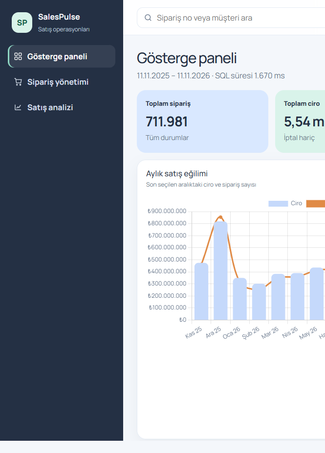
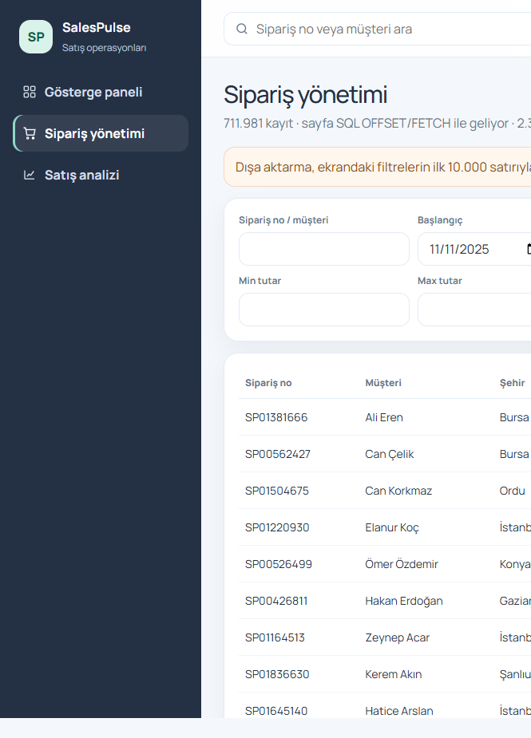
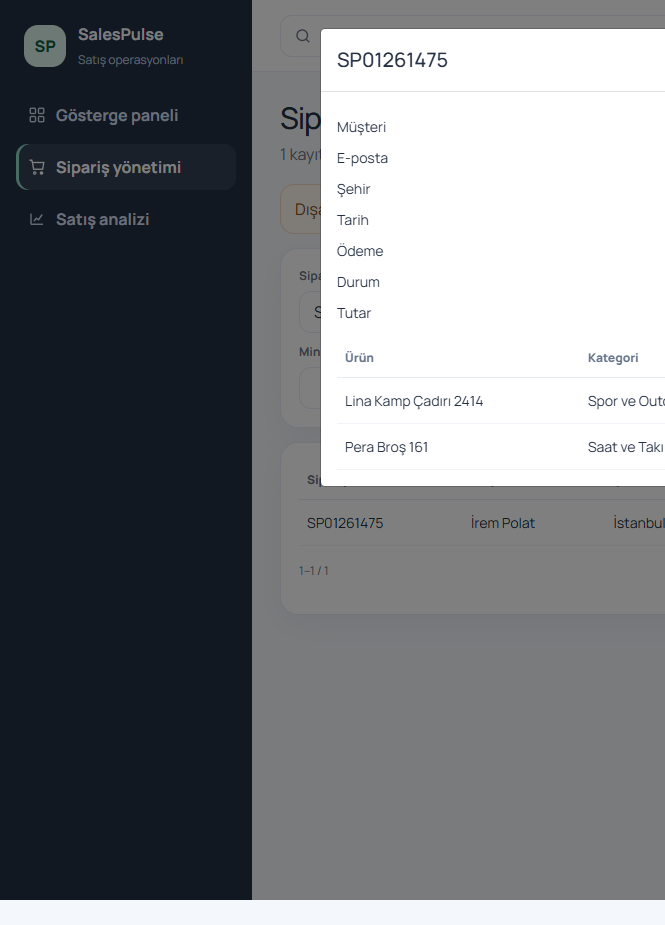
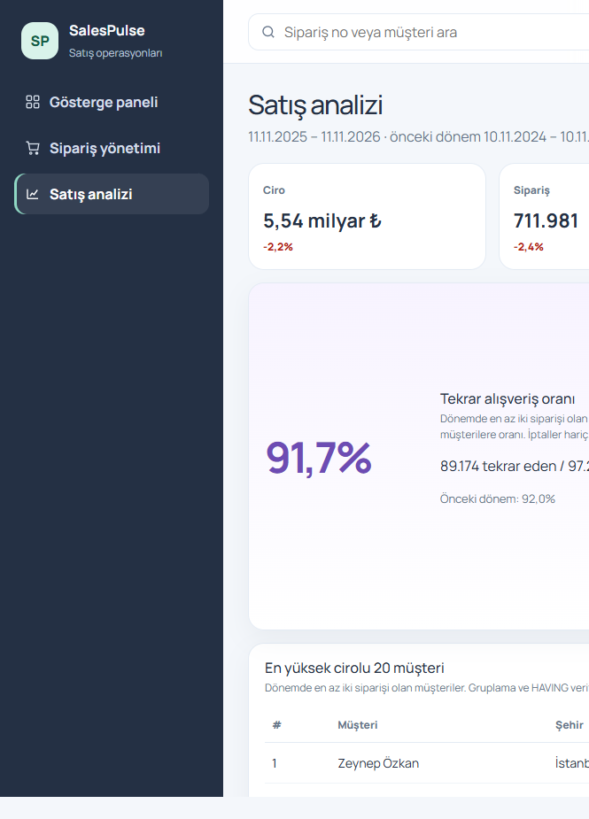
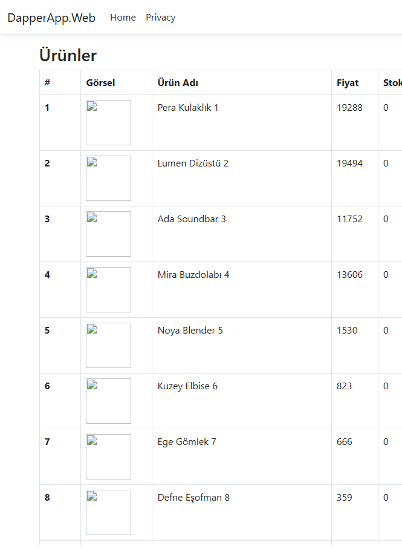
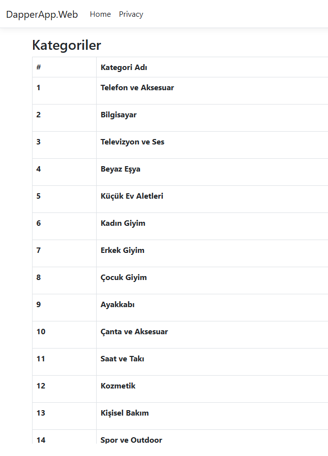
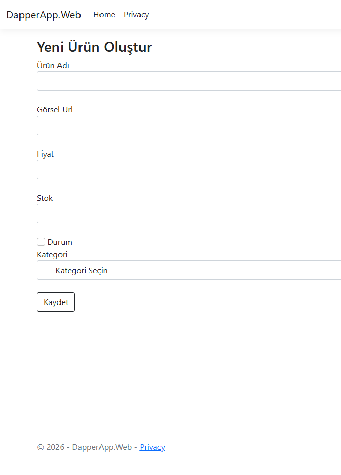
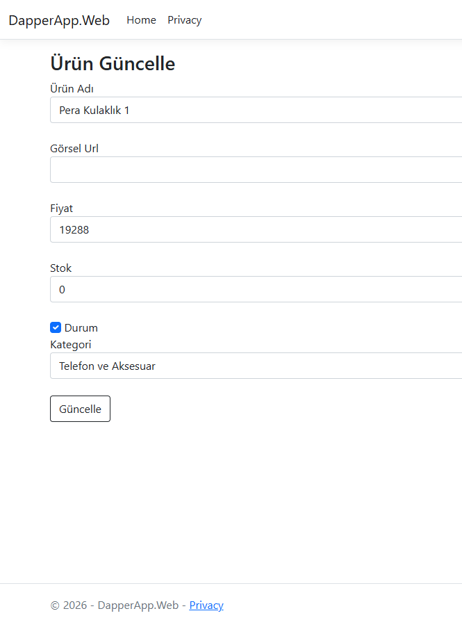
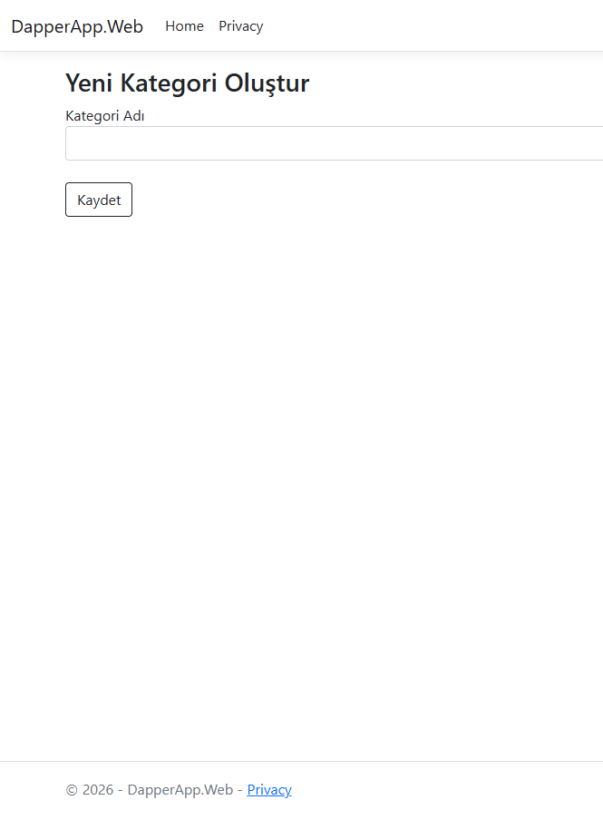
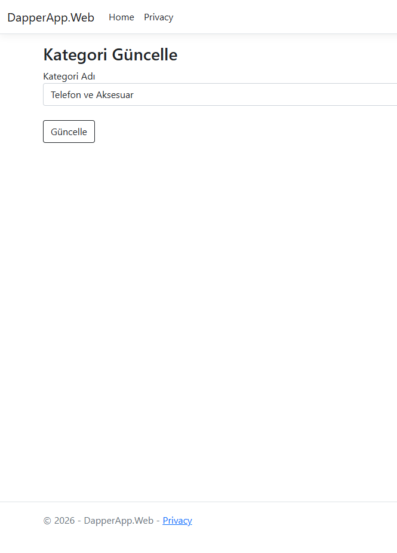

# SalesPulse

Türkiye genelinde satış yapan bir e-ticaret operasyonunun yönetim paneli. Sipariş, ürün ve kategori verisi SQL Server üzerinde `DapperProjectDb` veritabanında durur. Panel, ürün ve kategori ekranlarıyla aynı yolu kullanır: `DapperDbContext`, `SqlConnection` ve parametreli Dapper sorguları. Filtre, sıralama, sayfalama ve rapor toplamları veritabanında çalışır.

## Ekranlar

Gösterge paneli, son 12 ay. Kartlar ve grafikler seçilen tarih aralığı için yeniden sorgulanır.



Sipariş listesi. Arama, şehir, durum, tutar ve tarih filtreleri sunucuda uygulanır. Sayfalama `OFFSET/FETCH` kullanır.



Sipariş satırına tıklanınca ödeme ve kalemler aynı veritabanından gelir.



Satış analizi, önceki dönemle karşılaştırma, tekrar alışveriş oranı ve en yüksek cirolu müşteriler.



Ürün ve kategori ekranları da `DapperProjectDb` içindeki katalogu okur.













## Ne var?

- Gösterge paneli: toplam sipariş, ciro, müşteri, ortalama sepet, aylık eğilim, ilk 10 kategori, ilk 10 şehir, durum dağılımı, adet ve ciroya göre ilk 10 ürün.
- Sipariş yönetimi: sipariş no, müşteri, şehir, tarih, tutar, ödeme ve durum. Arama, tarih, şehir, durum ve tutar filtreleri, kolon sıralama, sayfalama, detay penceresi ve en fazla 10.000 satırlık CSV.
- Satış analizi: en yüksek cirolu 20 müşteri, şehir sıralaması, kategorilerin aylık performansı, en yüksek gelirli ürünler, tekrar alışveriş oranı ve eşit uzunluktaki önceki dönemle karşılaştırma.

Ciro, ortalama sepet, kategori, şehir, ürün ve tekrar oranı iptal edilen siparişleri içermez. Toplam sipariş ve durum dağılımı tüm kayıtları sayar.

## İlişkiler

```text
Cities 1───* Customers 1───* Orders 1───* OrderDetails *───1 Products *───1 Categories
                              │
                              └───1 Payments
         Cities 1───* Orders (sipariş anındaki şehir)
```

| Tablo | Hacim | Rol |
| --- | ---: | --- |
| Cities | 81 | İl ve bölge |
| Categories | 30 | Ürün kategorisi |
| Products | 5.000 | Ürün, fiyat, stok, görsel |
| Customers | 100.000 | Ad, e-posta, şehir |
| Orders | 2.000.000 | Sipariş no, tarih, tutar, durum |
| OrderDetails | 3.500.000 | Kalem, adet, satır tutarı |
| Payments | 2.000.000 | Sipariş başına bir ödeme |

Sipariş tarihleri 1 Ocak 2024 ile veri üretim günü arasındadır. İstanbul, Ankara ve İzmir daha sık seçilir. Kasım, Aralık, hafta sonu ve kampanya günleri daha yoğundur. Sipariş numaraları `SP` ile başlar. Durumlar: Tamamlandı, Kargoda, Beklemede, İptal, İade.

2.000.000 sipariş / 100.000 müşteri oranı, 12 aylık tekrar alışveriş oranını yükseltir. Daha kısa bir aralık seçildiğinde oran düşer.

## Katmanlar

- `DapperApp.Web/Context/DapperDbContext.cs` — `SqlConnection` bağlantısı
- `Services/Products`, `Services/Categories` — katalog
- `Services/Dashboard`, `Services/Orders`, `Services/Sales` — raporlar, aynı Dapper kalıbı
- `Areas/Admin` — sayfalar
- `database/01_schema.sql` — satış şeması
- `database/02_stored_procedures.sql` — saklı yordamlar
- `database/03_indexes.sql` — satır indeksleri ve columnstore
- `database/05_copy_into_dapperproject.sql` — üretilen veriyi `DapperProjectDb` içine alır
- `SalesPulse.DataGen` — toplu veri üretimi. Bu bir API değildir, bir kez çalışan konsol uygulamasıdır

Panel sorguları `string` SQL ve `DynamicParameters` ile yazılır. Sıralama kolonu beyaz listededir. Sipariş numarası araması `SP` ile başlıyorsa tekil indeks üzerinden eşitlikle yapılır.

## Kurulum

1. SQL Server Express çalışır durumda olsun. Bağlantı `DapperApp.Web/appsettings.json` içindeki `SqlConnection` anahtarıdır. Varsayılan sunucu `CEMRE\SQLEXPRESS`, veritabanı `DapperProjectDb`.
2. Veriyi üretin. İlk çalıştırma `SalesPulseDb` oluşturur, 2 milyon sipariş yazar ve indeksli süreleri ölçer:

```powershell
dotnet run --project SalesPulse.DataGen
```

Farklı bir sunucu için `--server "SUNUCU\INSTANCE"` ekleyin. Yeniden üretmek için `--force` kullanın. Bu komut `SalesPulseDb` veritabanını siler.

3. Üretilen satırları panelin okuduğu veritabanına alın:

```powershell
sqlcmd -S "CEMRE\SQLEXPRESS" -E -C -d DapperProjectDb -I -t 0 -i database\05_copy_into_dapperproject.sql
sqlcmd -S "CEMRE\SQLEXPRESS" -E -C -d DapperProjectDb -I -t 0 -i database\03_indexes.sql
```

Kopya betiği `DapperProjectDb` içindeki eski kategori ve ürün satırlarını, sipariş kalemlerinin bağlanabilmesi için satış kataloğuyla değiştirir.

4. SQL Express sorgu belleği düşükse analitik sorgular bellek izni bekler. 16 GB RAM olan bir makinede alt sınır 1024 MB yeterlidir:

```sql
EXEC sp_configure 'show advanced options', 1;
RECONFIGURE;
EXEC sp_configure 'min server memory (MB)', 1024;
RECONFIGURE;
```

5. Yalnızca web projesini başlatın:

```powershell
dotnet run --project DapperApp.Web --launch-profile http
```

Adres: `http://localhost:5036`

## Performans

Ölçüm SQL Server 2022 Express üzerinde, 12 aylık aralıkta yapıldı. Süreler sayfanın veritabanı sorgusudur.

| Ekran | Süre |
| --- | ---: |
| Gösterge paneli, 12 ay | 1,7 sn |
| Gösterge paneli, 30 gün | 0,5 sn |
| Sipariş listesi, sayfa 2 | 1,5 sn |
| Sipariş no araması (`SP01261475`) | 21 ms |
| Satış analizi, 12 ay (plan hazırken) | 2,8 sn |

İlk satış analizi isteği plan derlemesi yüzünden yaklaşık 10 saniye sürebilir. Sonraki istekler yukarıdaki süreye iner.

Aynı aralıkta, indeks eklenmeden önce ölçülen üç sorgu `database/performance-results.md` dosyasındadır.

| Sorgu | Önce | Sonra | Önce okuma | Sonra okuma |
| --- | ---: | ---: | ---: | ---: |
| Sipariş sayfası, İstanbul + tamamlandı, OFFSET/FETCH | 432 ms | 1 ms | 20.469 | 180 |
| Aylık satış eğilimi, GROUP BY | 964 ms | 388 ms | 20.161 | 7.178 |
| En yüksek cirolu müşteriler, JOIN / GROUP BY / HAVING | 1.020 ms | 539 ms | 20.586 | 7.262 |

Karşılaştırılan sorgular:

1. İstanbul ve tamamlanmış siparişler için tarih aralıklı sayfa.
2. Aylık ciro ve sipariş sayısı.
3. En az iki siparişi olan müşterilerin cirosu.

İndeksler:

| İndeks | Karşıladığı ihtiyaç |
| --- | --- |
| `IX_Orders_OrderDate_Status` | Tarih aralığı, aylık eğilim, durum |
| `IX_Orders_City_OrderDate` | Şehir ve tarih filtresi |
| `IX_Orders_Customer_OrderDate` | Müşteri cirosu ve tekrar oranı |
| `IX_Orders_Pending` | Üst çubuktaki bekleyen siparişler |
| `IX_Customers_FullName` | Müşteri adı araması |
| `IX_OrderDetails_OrderId` | Sipariş detayı |
| `IX_OrderDetails_ProductId` | Ürün cirosu |
| `IX_Payments_OrderId_Cover` | Ödeme yöntemi |
| `NCCI_Orders_Analytics` | Sipariş toplamları |
| `NCCI_OrderDetails_Analytics` | Kalem toplamları |
